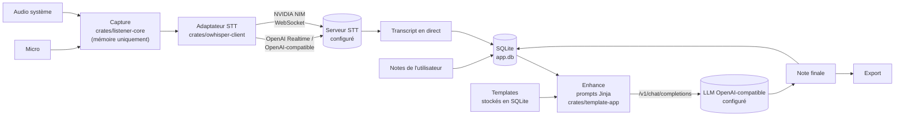

Cette page décrit l'état actuel du code de Syntheo Desktop, à l'intention des développeurs et des contributeurs. Syntheo Desktop est un fork d'Anarlog (Fastrepl), distribué sous licence MIT : l'origine du code est détaillée dans `NOTICE.md`.

## Vue d'ensemble du monorepo

Le dépôt est un monorepo **pnpm** (`pnpm-workspace.yaml` : `apps/*`, `packages/*`, `plugins/*`) doublé d'un **workspace Cargo** (`Cargo.toml` : `apps/cli`, `apps/desktop/src-tauri`, `crates/*`, `plugins/*`). Il ne contient que deux applications : le client desktop et la CLI.

| Rôle | Emplacement | Contenu |
| --- | --- | --- |
| Application desktop | `apps/desktop` | Tauri 2. Interface React 19 en TypeScript, construite avec Vite. Routage, requêtes et formulaires avec TanStack (Router, Query, Form), état local avec Zustand. Le cœur natif est dans `apps/desktop/src-tauri`. |
| CLI | `apps/cli` | Binaire `syntheo` en Rust : lecture et export des réunions, propositions de modification, serveur MCP. |
| Plugins Tauri | `plugins/*` | Pont entre l'interface et le natif : `db`, `transcription`, `dictation`, `template`, `tantivy`, `export`, `store2`, `detect`, `notification`, `shortcut`, `local-api`, `mcp`… Chaque plugin expose des commandes typées, générées pour TypeScript avec `tauri-specta`. |
| Capture audio | `crates/audio*`, `crates/aec`, `crates/vad*`, `crates/listener-core` | Accès aux périphériques, capture du micro et de l'audio système, annulation d'écho, détection d'activité vocale, supervision de la session de capture. |
| Transcription | `crates/owhisper-client`, `crates/transcript`, `crates/ws-client` | Adaptateurs STT et assemblage du transcript. |
| Données | `crates/db-core`, `crates/db-app`, `crates/db-migrate`, `crates/storage` | Accès SQLite (sqlx), schéma et migrations, emplacement des dossiers de données. |
| Prompts et export | `crates/template-app`, `crates/export-core` | Prompts Jinja pour le LLM, export PDF via Typst. |
| Accès agents | `crates/agent-access` | Opérations partagées par la CLI et le serveur MCP. |
| Paquets front | `packages/*` | `ui` et `design-system` (composants), `editor` (éditeur ProseMirror), `db`, `db-react`, `db-tauri` (accès aux données côté TypeScript), `provider-validation` (validation des endpoints), `utils`. |

## Flux principal

1. **Capture.** `crates/listener-core` capture séparément le micro et l'audio système. Une connexion STT est ouverte par canal, ce qui fournit une première séparation des locuteurs (vous et les autres participants).
2. **Transcription.** `crates/owhisper-client` ne contient que des adaptateurs on-premise : le protocole OpenAI (Realtime et `/v1/audio/transcriptions`, dans `adapter/openai` et `adapter/openai_compatible_batch.rs`) et NVIDIA NIM (`adapter/nvidia.rs`). Aucune URL n'est fournie par défaut : l'utilisateur saisit celle de son serveur. Le même client sert la dictée (`plugins/dictation`) et l'import de fichiers audio.
3. **Transcript en direct.** Les segments reçus sont assemblés puis enregistrés dans SQLite. Si le flux STT s'interrompt, la session se reconnecte sans redémarrer la capture.
4. **Enhance.** À la fin de la réunion, l'interface fusionne les notes et le transcript (`apps/desktop/src/store/zustand/ai-task/`). Les prompts sont rendus côté Rust par `plugins/template` à partir des modèles Jinja de `crates/template-app/assets` (`enhance.*`, `title.*`, `chat.*`…). Les templates de compte rendu sont stockés en base (migration `20260413020000_templates.sql`). L'appel au LLM passe par le SDK `ai` et `@ai-sdk/openai-compatible`, vers l'unique endpoint configuré.
5. **Note finale et export.** Le résultat est enregistré en base, puis exportable : PDF via `crates/export-core`, et Markdown ou JSON depuis la CLI.

## Stockage local

- **Base SQLite** : fichier `app.db` (`apps/desktop/src-tauri/src/db.rs`), accédé via sqlx (`crates/db-core`). Le schéma et ses migrations SQL sont dans `crates/db-app/migrations`, appliquées par `crates/db-migrate`.
- **Recherche plein texte** : `plugins/tantivy` maintient un index `search_index` dans le dossier de données. Des déclencheurs SQLite alimentent une file `search_index_dirty`, que l'application consomme pour réindexer les sessions, documents et transcripts modifiés.
- **Emplacement des données** : le dossier `syntheo` du répertoire de données de l'utilisateur, par exemple `~/.local/share/syntheo` sous Linux (`crates/storage`, identifiant d'application `fr.willisback.syntheo`).
- **Clés d'API** : jamais en base ni dans le binaire. `plugins/store2` les range dans le trousseau du système via la crate `keyring` : Secret Service sous Linux, Credential Manager sous Windows.

## Garanties d'architecture

Ces garanties sont appliquées dans le code et protégées par des tests. Ceux de `apps/desktop/src/` tournent avec Vitest à chaque pull request.

| Garantie | Tests garde-fous |
| --- | --- |
| **Aucun audio sur disque.** L'audio reste en mémoire le temps d'être envoyé au serveur STT. Il n'y a ni lecteur audio ni retranscription après coup. | `no-audio-at-rest.test.ts` ; côté Rust, `supervisor_writes_no_audio_to_session_dir` (`crates/listener-core`) vérifie qu'aucun fichier audio n'apparaît dans le dossier de session, et `managed_settings_require_no_audio_retention` (`crates/db-app`) refuse toute autre rétention que « aucune ». |
| **Inférence uniquement vers les endpoints configurés.** Seuls les adaptateurs STT on-premise et un fournisseur LLM OpenAI-compatible existent, sans URL par défaut. HTTP en clair n'est accepté que vers un hôte privé. Aucune empreinte d'appareil n'est envoyée dans les en-têtes. | `stt-on-prem.test.ts`, `llm-on-prem.test.ts` |
| **Ni compte, ni cloud, ni télémétrie.** Les modules d'authentification, de partage et de synchronisation sont supprimés, et aucune dépendance d'analyse ou de rapport d'erreur n'est déclarée. | `no-cloud-imports.test.ts` |
| **Périmètre du dépôt.** Seuls le desktop et la CLI subsistent : aucune application serveur, web ou mobile. | `monorepo-scope.test.ts` |
| **Conformité documentée.** `docs/conformite/rgpd.md` doit inventorier chaque flux réseau et chaque stockage. | `docs-rgpd.test.ts` |
| **Français d'abord.** L'interface s'affiche en français par défaut, et l'anglais reste disponible. | `apps/desktop/src/i18n/locales.test.ts` |

Les flux réseau sans rapport avec l'inférence, encore présents dans le code, sont listés dans la page [RGPD](/conformite/rgpd).

## Interfaces pour les agents

- **CLI** (`apps/cli`) : le binaire `syntheo` lit directement la base `app.db`, en lecture seule pour la consultation et l'export. Les modifications passent par des **propositions**, que l'utilisateur relit ensuite dans l'application. Voir la [référence de la CLI](/reference/cli).
- **Serveur MCP** : `syntheo mcp` lance un serveur MCP en stdio (`apps/cli/src/mcp.rs`, bibliothèque `rmcp`). Il expose la liste des réunions, les transcripts, l'export, l'import d'un enregistrement et les propositions de modification. Côté application, `plugins/local-api` et `plugins/mcp` portent les commandes et les types associés.

La vue d'ensemble se trouve dans [Agents](/agents/overview).

## Build, CI et publication

Les workflows se trouvent dans `.github/workflows/`.

- **Gates de pull request** : `ci-test` (Vitest), `ci-code-quality` (formatage, lint, typage, cohérence des commits et des lockfiles ; clippy et `cargo test` sur `main`), `ci-security` (analyse des dépendances, détection de secrets), `ci-codeql` et `ci-traceability` (issue liée, type de PR, impact semver).
- **Release** (`release.yml`, à chaque push sur `main`) : la version est calculée depuis les Conventional Commits. `feat` donne une version mineure, `fix` et `perf` un correctif, et un `!` une version majeure. Un commit marqué `[skip release]` ne publie rien.
- **Paquets** : AppImage et `.deb` pour Linux. Pour Windows, `build-windows.yml` produit un installeur NSIS (`.exe`) et un `.msi`, signés via Azure Artifact Signing lorsque les secrets Azure sont fournis.
- **Intégrité** : un SBOM SPDX (Syft), des fichiers `SHA256SUMS` et `SHA256SUMS-windows`, une attestation de provenance vérifiable avec `gh attestation verify`, puis une publication sur les GitHub Releases.

Aucun build macOS n'est publié pour l'instant.

## Conformité

Les données stockées, les flux réseau et les responsabilités de l'utilisateur sont détaillés dans [Syntheo Desktop et le RGPD](/conformite/rgpd).
